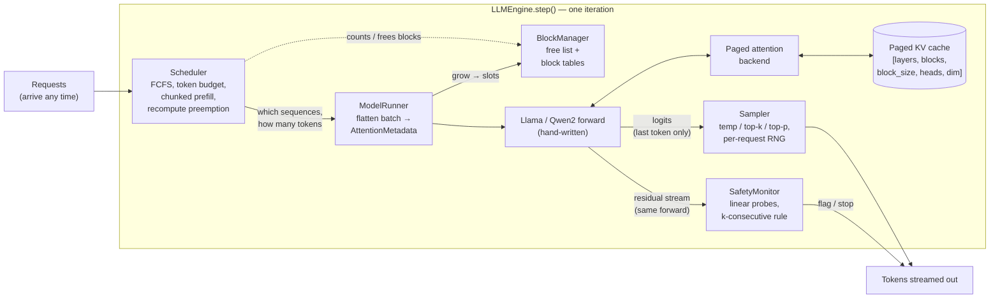

# safeinfer

[](https://github.com/zhengbrody/Safeinfer/actions/workflows/test.yml)


**An LLM inference engine built from scratch in PyTorch, with a safety monitor
that runs inside the decode loop.**

safeinfer serves Llama and Qwen2 models with a **paged KV cache** and
**continuous batching** (chunked prefill and recompute preemption, in the style
of vLLM). On every forward pass it also reads hidden activations and scores
them with **linear safety probes**. This lets the engine flag or stop a harmful
generation partway through decoding without running a second model.

It has about 3.1k lines of engine code and 1.1k lines of tests. The forward
pass, paging, scheduling and sampling are written by hand. HuggingFace
`transformers` is used only to check outputs in tests and as the benchmark
baseline. It is never imported by the engine.

---

## Highlights

| | Result |
|---|---|
| **Correctness** | Real Llama-3.2-1B-Instruct logits are **bit-identical to HuggingFace** (fp32, max diff 0). Greedy output matches token for token under batching, chunked prefill, staggered arrivals and forced preemption |
| **Memory** | On 1,000 ShareGPT conversations, paging cuts KV-cache waste from **80.6% to 1.8%** and fits **4.4× more concurrent requests** in the same memory |
| **Latency** | Continuous batching gives **1.6× HuggingFace's output throughput** and cuts **p50 time-to-first-token from 24.2 s to 1.6 s** (CPU smoke run, see the caveat below) |
| **Safety** | A probe reading prompt activations detects harmful requests better than Llama Guard 3 1B by AUROC (**0.992 vs 0.967**). It flags **0.8%** of XSTest's safe prompts, compared with Guard's **21%**. The cost is **one dot product per request** |
| **Testing** | 88 tests, including property-based (`hypothesis`) tests of the block manager and the scheduler. Key tests are mutation-checked: deliberately breaking the code makes them fail. CI runs lint and the CPU suite on every push |

---

## Architecture



On every step the **scheduler** picks which sequences run and how many tokens
each one gets. The **model runner** combines all of them into one flat token
batch. A single **forward pass** then serves prefills, chunked prefills and
decodes together. The **sampler** draws the next tokens, and the **safety
monitor** scores activations captured during that same forward pass.

### Components

| Layer | Module | What it does |
|---|---|---|
| Model | `model/llama.py`, `model/loader.py` | Hand-written Llama/Qwen2 forward (RMSNorm, RoPE with llama3 scaling, GQA, SwiGLU, qkv bias). Loads safetensors into a model initialized on the meta device, using HF parameter names |
| Memory | `memory/block_manager.py`, `memory/kv_cache.py` | Free list and per-sequence block tables (bookkeeping only, no tensors). Physical K/V blocks sized from a memory budget |
| Attention | `attention/torch_paged.py`, `attention/dense.py` | Writes K/V to slots, gathers blocks and runs SDPA with an explicit offset causal mask. The dense backend is the correctness reference |
| Scheduling | `scheduler/scheduler.py`, `scheduler/sequence.py` | Iteration-level FCFS with a token budget, chunked prefill and recompute preemption |
| Engine | `engine/engine.py`, `engine/model_runner.py`, `engine/sampler.py` | Runs schedule → run → sample → monitor → update. Each step either completes or changes nothing |
| Safety | `safety/probe.py`, `safety/monitor.py`, `safety/*` | Online monitor plus an offline pipeline: dataset building, collection, activation checks, judge labeling, training and calibration |
| Bench | `bench/*` | Poisson arrivals over ShareGPT lengths. Records TTFT/TPOT/E2E p50 and p99. Includes an HF baseline and a KV-utilization analysis |

---

## Design decisions

- **One flattened token batch, one code path.** `forward(input_ids[T], positions[T], backend, meta)`
  takes every sequence concatenated together. Each sequence's new tokens are
  the last `query_len` of its `context_len` tokens, so prefill, decode and
  chunked prefill are the same case. Adding continuous batching required no
  changes to the model.
- **Attention is a pluggable backend.** The model owns the projections and
  RoPE. The backend owns KV storage and the attention op. A new kernel (Triton,
  week 5) must match `DenseAttention` before it is benchmarked.
- **Steps are all or nothing.** `ModelRunner` checks KV capacity for the whole
  batch before allocating anything. The scheduler only counts blocks and the
  runner only allocates them. Because each mutation has a single owner, the
  property-test invariants stay simple.
- **Recompute preemption that cannot livelock.** When memory runs out, the
  newest running sequence frees its blocks, keeps its generated tokens and
  goes back to the front of the queue. Config checks guarantee the sequence at
  the head of the queue always fits in an empty engine.
- **Sampling is reproducible under batching.** Each seeded request draws from
  its own `torch.Generator`. Its samples are identical whether it runs alone,
  in a batch or after a preemption, and this is tested.
- **Probe state is keyed by output position, not by forward pass.** A
  recompute re-runs old tokens through the model. If the k-consecutive flag
  counter were keyed by forward passes, it would double-count those tokens.
- **The baseline is fair.** HF `generate` is credited with per-token streaming
  timestamps, and only requested tokens count toward its throughput.

Rationale for every decision is in [CLAUDE.md](CLAUDE.md).

---

## Results

### Paged KV cache: memory

Setup: 1,000 ShareGPT requests (mean final length 456 tokens),
Llama-3.2-1B, a 16 GiB KV budget and `max_model_len` 2048.

| Scheme | Utilization | Waste | Max concurrent requests |
|---|---|---|---|
| Contiguous (reserve 2048) | 19.4% | 80.6% | 256 |
| **Paged, block 16** | **98.2%** | **1.8%** | **1,132 (4.4×)** |
| Paged, block 8 / 32 | 99.1% / 96.3% | 0.9% / 3.7% | 1,142 / 1,112 |

Concurrency here is a memory bound; compute saturates well before ~1,100
requests.

### Continuous batching: latency

Setup: Llama-3.2-1B in fp32 on CPU, 16 ShareGPT requests all arriving at t=0,
batch size 8.

| Backend | Output tok/s | p50 TTFT | p50 E2E |
|---|---|---|---|
| HF `generate` (static batching) | 29.7 | 24.2 s | 45.7 s |
| safeinfer, static batching | 37.5 | 16.2 s | 31.8 s |
| **safeinfer, continuous batching** | **48.5** | **1.6 s** | **24.8 s** |

> These CPU numbers only show the direction of the effect. GPU rate sweeps
> (HF vs engine-static vs engine, Poisson arrivals from 1 to ∞ req/s) are
> scripted and pending.

### Safety probes

Setup: Llama-3.2-1B-Instruct; 3,829 prompts built from 1,950 base requests
(AdvBench, HarmBench, JBB, Alpaca, XSTest) across 5 jailbreak families. Each
generation is labeled by whether it **actually complied**, as judged by Llama
Guard 3 1B running on this engine. The prompt's topic is not the label.
Splits are grouped by base request, so no test request appears in training.

**Input probe** (layer 10, last prompt token) vs Llama Guard 3 1B on the same
prompts:

| | AUROC | Harmful flagged | Benign flagged | XSTest safe flagged |
|---|---|---|---|---|
| **Input probe** @ 1% val FPR | **0.992** | 88.9% | **1.7%** | **0.8%** |
| Llama Guard @ 0.5 | 0.967 | 93.7% | 11.6% | 21.2% |

**Output probe** (layer 8, stops the generation after k=2 consecutive flags):
AUROC 0.972, TPR 39% [29, 50] at 1.3% benign FPR. In leave-one-family-out
tests, refusal suppression is the main out-of-distribution gap (AUROC 0.88).

**Overhead:** one 2048-dimensional dot product per token. CPU throughput was
98.6 tok/s with the probe and 99.7 tok/s without it, which is within
run-to-run noise.

**Takeaway:** the input probe is the strong result. It matches a dedicated
guard model's detection with far less over-refusal, at almost no cost. The
output probe ranks generations well, but at a strict FPR it catches fewer
than streaming Guard and later. All CIs are Wilson 95% intervals.
Caveat: the probe was trained on these sources, while Guard is zero-shot.
XSTest is unseen by both.

---

## Debugging story: a silent MPS kernel bug

The script that compares stored activations against an fp32 CPU recompute
(`safety/verify_acts.py`) found that **33 of 120 sampled generations** in the
first data collection had diverged. The cause was nondeterminism in PyTorch
2.9's MPS single-query SDPA kernel: unmasked decode attention sometimes
returned NaN or values that were finite but wrong. Masked prefill attention
was always correct.

The fix passes an explicit mask on MPS during decode; the CUDA path is
unchanged. After regenerating the data, every sampled generation had cosine
similarity of at least 0.9995 to the recompute. Without that verification
step, the probes would have been trained on corrupted data.

---

## Quickstart

```bash
pip install -e ".[dev]"
pytest -q                                   # 88 tests, ~5 s on CPU

# serving benchmark: hf | engine-static | engine
python -m safeinfer.bench.run_bench --backend engine \
    --model meta-llama/Llama-3.2-1B-Instruct \
    --dataset data/sharegpt.json --num-requests 200 --rate 4 \
    --enable-chunked-prefill --out results/engine_r4.json

# real-checkpoint parity vs HuggingFace (~10 GB RAM)
SAFEINFER_TEST_MODEL=meta-llama/Llama-3.2-1B-Instruct pytest tests/test_real_checkpoint.py
```

The full probe pipeline (dataset → collect → verify → judge → train) is
documented in [CLAUDE.md](CLAUDE.md#commands).

---

## Roadmap

- [x] **Model:** hand-written Llama/Qwen2, bit-exact against HF, plus a benchmark harness and CI
- [x] **Paged KV cache:** block manager, paged attention, KV-utilization analysis
- [x] **Continuous batching:** scheduler, sampler, preemption, reproducible seeded sampling
- [x] **Safety probes:** in-loop monitor, labeled dataset, calibrated probes, baselines
- [ ] **GPU benchmarks:** rate sweeps, probe overhead under load, Llama-3.1-8B
- [ ] **Speed:** CUDA graphs for decode, a Triton paged-decode kernel, and a profiler-backed gap analysis against vLLM

For the full engineering notes, including design decisions, numerics,
commands and the changelog, see **[CLAUDE.md](CLAUDE.md)**.
